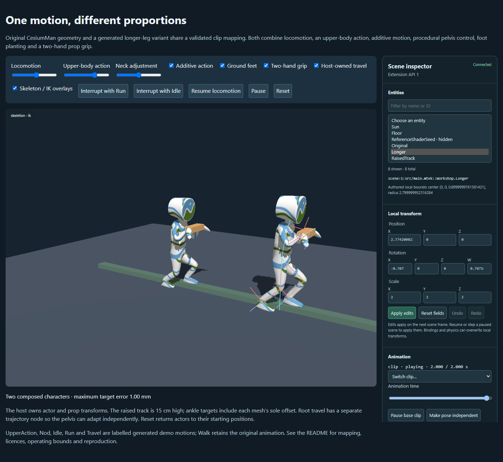

# Production character composition and current compute acceptance

Date: 2026-10-27. Continues areas 2, 3, 8 and 10 of the
[scorecard](../scorecard.md). The complete platform roadmap remains open.

## Delivered workflow

The [workshop](../../../examples/character-composition/README.md) compiles ordinary
Mtek scene/material source and uses public animation, retargeting, extension and
inspector APIs. Original CesiumMan geometry and a generated compatible proportion
variant combine synchronized locomotion, masked override/additive actions, an
additive neck motion, procedural neck/pelvis adaptation, oriented feet on unequal
heights, two-hand prop grips and optional host-owned root travel. Authored vertex
position/normal/UV/payload outputs and directional shadows remain active.

The original Walk animation and texture bytes are preserved. Additional hold,
time-scaled, trajectory and action motions are labelled generated demo content.
The variant changes named leg lengths by 20% and mapped arm lengths by -10%,
rebinds its geometry and transfers all clips through the public world-frame
retarget API. This is one original rig plus a generated compatible derivative,
not evidence for arbitrary humanoid recognition or two unrelated production rigs.
The deterministic asset check preserves all 57 original walk channels, maps all
six clips, verifies the length ratios and obtains identical repeated derivatives.
Original files and frozen animation workload definitions remain unchanged.

Targets invert the known affine material stretch. Explicit knee seeds, toe
effectors, ankle-to-sole profiles and bounded adaptive pelvis crouch make this
scene's feet and prop constraints compose. These are documented host adaptations,
not a general anatomical solver, navigation system or terrain-query implementation.
The straight trajectory and fixed stage have finite operating bounds.

## Runtime numerical guard

The original animated scales contain about 1.5 ppm of exporter round-off. They
previously failed the uniform-frame guard during world retargeting/IK orientation.
[Decision 0209](../../../spec/decisions/0209-skeletal-scale-round-off.md) defines a
shared finite/positive input check with fixed `16 * 2^-23` relative round-off.
Source scale keys and evaluated values remain intact. Larger anisotropy remains
an error. Independent matrix-axis and endpoint checks retain their accuracy gates;
this is input admissibility, not a relaxed pose/render comparison.

## Correctness and lifecycle evidence

[Validation](validation.json) indexes sources, artifacts, raw reports, retained
failed/intermediate candidates and PNG hashes. Accepted records are under
[`accepted/`](accepted/). Radeon RX 7900 XTX and SwiftShader are on the same PC;
these remain two backends on one physical device.

- **32 CPU cases:** both proportions, root ownership on/off, override/additive
  action, and 30/60/144 fps or uneven deltas, each over six seconds. Actual endpoint
  error is below 2 mm, orientation error below 0.1 mrad, and independently skinned
  leg/foot vertices stay within 3 mm of their planned surface/lift. Each case
  observes three crossings of both phase markers. Analytic root distance agrees,
  extracted trajectory display is zero, and procedural pelvis adaptation survives.
- **Two interrupted transitions** preserve the composed pose at the interruption;
  **four steady-mode controller restorations** preserve palette/origin state.
- **Five CPU/GPU render comparisons per backend:** locomotion/action/constraints,
  additive action, interrupted transition, extracted-root travel and recovered
  root composition. Static reference geometry is CPU-skinned from original packed
  vertices and sampled palettes, then independently affine-deformed. A compiled
  fragment-only material excludes the GPU skin/authored-vertex path from reference
  geometry. Shadows are included. Raw reference/main pixels, palettes, poses and
  transforms are retained. No pixel exceeds the fixed two-channel-step tolerance;
  visible character/prop controls rule out empty-scene comparisons.
- Device loss retains the CPU world: steady compositions **and a 20%-complete
  crossfade** recover with exact pixels and unchanged transition progress. A
  separate new-player restoration fallback is documented: an unfinished fade
  resumes at its target clip/time because its source pose is not a public serialized
  state. That fallback is not used by the tested device-recovery path.
- The actual controls, constraint toggles, pause/resume, blend selection, overlay
  selection and three consecutive Reset operations pass. Retired applications,
  reference mounts and final UI disposal all return seven tracked resource
  categories to zero. Native canvas captures prove rendered scene content; both
  final workshop screenshots were visually reviewed.

## Compute shadow and capability recheck

All **18 current compute acceptance tests** pass, nine per backend, against the
current runtime. They include all three shadow qualities, off-camera casters,
source-outside/final-inside bounds, pending output, completed-snapshot recovery,
detach/reset/replacement and independent CPU/direct-WGSL numerical/render
references. The context capability regression passes; coverage and release-doc
audits agree with executable standalone compute and material-local E4901.
The earlier compute progress record now clearly labels its superseded gate text.
This does not add unrestricted compute operations or additional device evidence.

## Other checks and retained failures

All **1,661 runtime tests** pass. The broader animation/lighting/material selection
passes **78 browser checks**, and the inspection selection passes **eight**,
across both backends. Root TypeScript, example type-aware lint/TypeScript,
runtime lint, canonical Mtek formatting, direct pinned-GBNF validation of both
projects, public source builds, release packaging, coverage and capability docs
pass. All eleven existing package limits hold without increases; the tight
stage-show zip is 713,307 / 740,000 bytes. Prebuilt artifacts match current dist
and recorded provenance. Prior complete Rust/grammar validation remains at the
[inspection checkpoint](../inspection-2026-10-27/validation.json); only the
affected context regression was repeated here because no Rust implementation
changed in this increment.

Retained candidates explain the corrections without relabelling old runs:

- The initial root/foot combination missed a target by about 3 cm. Separate
  trajectory ownership, reachable pelvis adaptation and measured sole offsets
  corrected the scene; target/geometry gates were retained.
- A new-player restore selected the already selected clip with a declarative
  no-op, preserving an unintended fade. Explicit base reselection fixes restore.
- One GPU harness supplied an invalid range value. Another captured an offscreen
  target as though it were the visible scene: its numeric pass is retained under
  rejected visual evidence. Native presented-canvas captures now have a content
  gate. Canvas `drawImage` readback also proved unsuitable for this presentation
  path and was replaced with native screenshot decoding.
- A later recovery test incorrectly assumed CPU players were reconstructed; the
  runtime retains them. The corrected test verifies exact unfinished-fade pixels.
  A large-array spread overflow and absent-versus-undefined metadata comparison
  were harness failures, also retained. No numeric/pixel tolerance was relaxed.
- Type-aware lint found a throw in `finally` that could mask an earlier failure.
  Disposal stays in `finally`; the reference ownership assertion runs afterward.

This adds correctness/workflow evidence, not new performance measurements.
Previous timing reports stay associated with their original runtime hashes.
Matched material/lighting and streaming/long-session workloads, production asset
features, movement corpus, persistent authored IDs/provenance, broader authoring
workflows, additional physical devices and release/productivity evidence remain.

