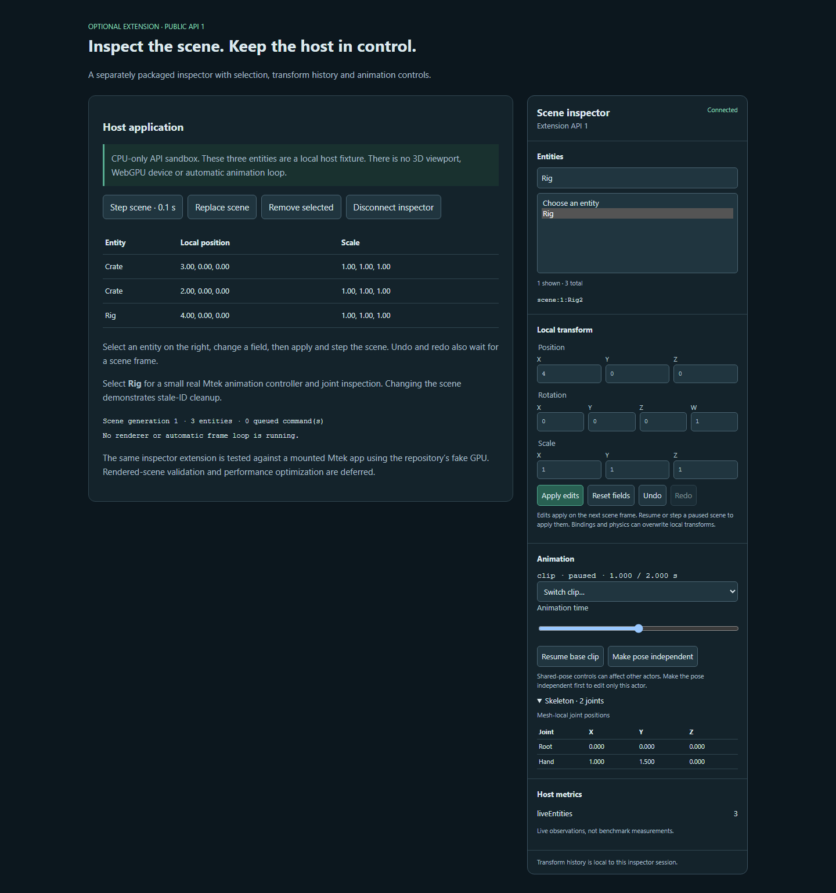

# External inspector and SDK package boundary

Date: 2026-10-26. Continues the platform roadmap while animation performance
optimization and CPU/GPU-heavy validation are **deferred at the user's request**.
That optimization remains planned; it has not been cancelled. No new rendering
benchmark, physical GPU run or Cargo build was performed for this increment.

## Delivered

- Separately packaged [`@mtek/inspector`](../../packages/inspector/README.md),
  consuming only the public extension API 1 types. Its JavaScript bundles its own
  controller/panel code and no runtime, compiler, GPU or physics implementation.
- Copied, immutable scene snapshots; name/ID filtering and selection; local
  position/quaternion/scale editing queued for the next before-frame hook.
- Atomic host batches, copied edit commands, bounded undo/redo, stale-ID handling,
  explicit scene/application lifecycle and observer-error isolation. Only edited
  fields enter transform history. Bindings/physics keep their normal ownership.
- Clip switching, base/locomotion pause/resume and scrubbing; mesh-local joint
  inspection; explicit shared-pose detachment before isolated editing.
- Optional, finite host metrics with units. Missing metrics stay unavailable;
  no physical-memory or whole-frame GPU-time inference is made.
- Scoped, accessible DOM panel with explicit disposal of listeners/subscriptions,
  throttled observations and no independent timer/render loop.
- Public runtime package entry/allowlist and [compatibility policy](../../packages/runtime-web/README.md).
  Local tarballs contain built ESM and public declarations, not implementation
  sources. The types entry works without pre-existing build output; unit-test
  prerequisites prepare the small SDK distribution on a fresh checkout.
- [CPU-only sandbox](../../examples/scene-inspector/README.md) and an opt-in
  **Scene inspector** control wired into the existing lighting studio. The
  studio's rendered integration check remains deferred; it was not activated.

These are private `0.1.0-dev` local packages, not a public registry release or a
stable compatibility guarantee. The policy distinguishes additive API 1 changes
from future breaking API versions and requires explicit version rejection.

## Validation obtained

[Package consumer](inspector/package-consumer.json): both SDK tarballs install
offline into an independent scratch project. Strict NodeNext TypeScript with
`skipLibCheck=false`, browser DOM types and no source aliases compiles the public
API. The installed consumer performs frame-queued edit/undo/cleanup, imports the
public runtime version and verifies that private source imports are rejected.
Type checking exposed a WebGPU-global conflict in the initial package attempt;
the final SDK uses TypeScript 6's DOM declarations without forcing duplicate globals.

**11 focused tests across two files pass with one worker**, including actual
mounted transforms, undo, setup rollback and unsupported versions through the
runtime's fake GPU. They also exercise real public animation players, locomotion,
stale IDs, command copying, observer disposal during a queue, throttled polling,
missing/invalid metrics and remount/cleanup. TypeScript, focused lint and sandbox
TypeScript checks pass. Broad workspace and hardware suites were not rerun.

[DOM verification](inspector/ui-verification.json) uses one short headless browser
with GPU/WebGPU disabled and a rejecting adapter-request shim: **zero GPU requests
and zero page errors**. It checks queued edits, undo/redo, dirty-field preservation,
invalid values, filtering, animation scrubbing/joints, replacement/remount,
untrusted labels as text and removal of both DOM listeners and subscriptions.
The screenshot was visually inspected, catching and fixing a hidden-label styling
regression. The sandbox models a small host fixture, not a rendered Mtek scene.

[Runtime identity](inspector/runtime-identity.json) verifies the measured runtime
JS and declarations remain byte-identical to the animation benchmark artifacts.
All five embedded artifacts also remain unchanged; source provenance is refreshed
for SDK metadata/lock changes. Existing dependency versions/integrities remain
pinned. The original runtime freeze, matched-animation definitions/report and
frozen AI archive are preserved. The inspector is opt-in and is not included in
compiled application payloads automatically.

## Remaining and deferred

- **Deferred:** independent-character CPU/GPU optimization identified by the
  matched animation report, and its required new measurements.
- **Deferred:** real rendered lighting-studio inspector checks and broader hardware
  regressions while CPU/GPU-heavy work is active.
- Still needed for the wider inspection/authoring roadmap: world-space skeleton,
  IK/collision overlays, transition/layer diagnostics, resource provenance/history,
  persistent authored IDs and complete authoring workflows.
- SDK release publication, independent-developer adoption and wider environment
  guarantees are separate from the local package/API proof obtained here.

No claim that the entire roadmap is complete follows from this increment.

