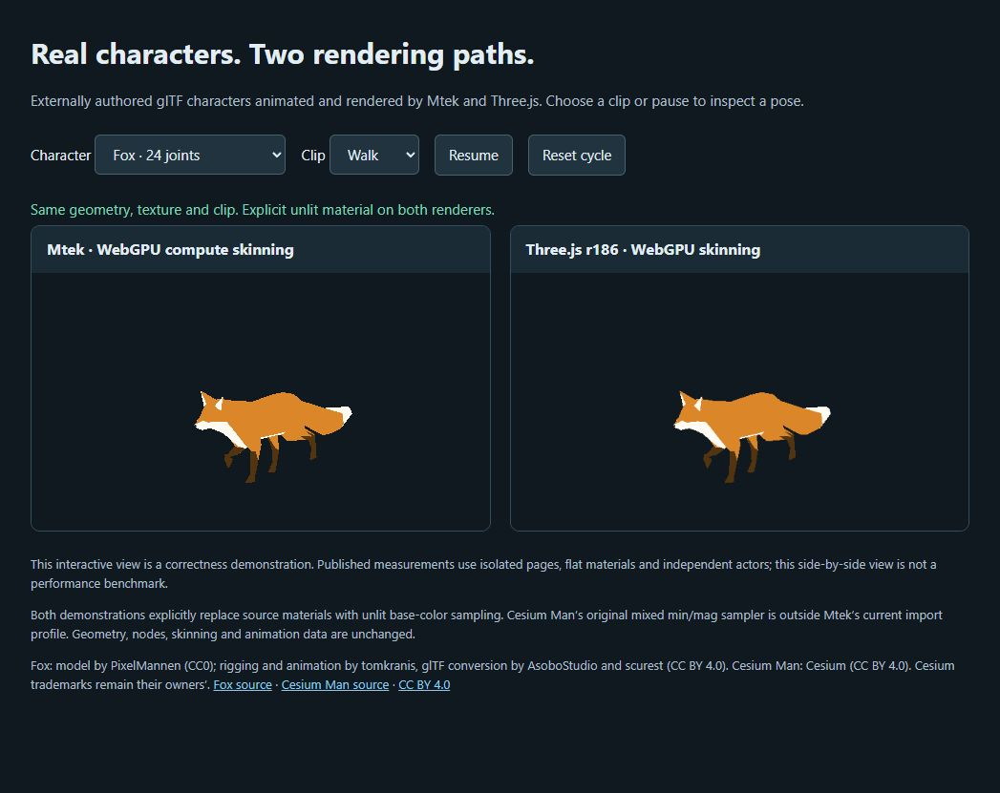

# Matched animation and authored characters

Date: 2026-10-26. This increment continues [the animation implementation](animation-progress.md).
The full platform roadmap remains incomplete. The frozen AI evidence archive and
original runtime-workload definitions are unchanged.

Follow-up, 2026-10-27: the [optimization checkpoint](animation-optimization-2026-10-27/checkpoint.md)
retains fresh complete before/after matrices using these unchanged definitions.
At 50 actors it records about 46% lower logical GPU buffer use and 8–9% lower GPU
pass time. Whole-frame CPU evidence is mixed and the unchanged Three.js controls
also drift; no whole-frame CPU win is claimed. The historical results below are
preserved.

## Delivered

- Pinned, unmodified Fox and Cesium Man GLBs with original metadata, licenses,
  source URLs and SHA-256 verification. [Asset provenance and conversion](../../benchmarks/runtime/animation/assets/README.md).
- Release Mtek and pinned Three.js 0.186.1 WebGPU workloads for 1, 10 and 50
  independent actors, using 1,728- and 3,273-vertex meshes respectively.
- Identical camera, original geometry/skin/clip data, actor phases, target and
  explicit flat materials. No pose sharing, throttling or culling in primary timings.
- Mandatory four-phase checks of every actor/joint and rendered pixels, followed
  by camera-edge comparisons with culling enabled/disabled and against Three.js.
- Separate CPU submission, compute-plus-render GPU pass sums, upload/draw,
  GC-controlled live memory and RAF-callback passes. Engine-specific pages keep
  the other engine's code out of each memory measurement.
- A textured [character demonstration](http://127.0.0.1:5185/demo.html) with every
  original clip, pause/reset controls and visible credits. Pause stops rendering.
- Frozen inputs, prepared-artifact verification, raw evidence and a deterministic
  report generator. CPU noise now waits/retries without discarding accepted passes;
  rejected attempts are retained and excluded from the report.

## Results

The [complete report](matched-animation/verified-2026-10-26/report.md) contains
**210 accepted passes**, three repeats of each measured case and metric, all raw
samples, actual adapter identities, source/build hashes and primary-pose PNGs.
[Validation](matched-animation/validation.json) records checks and limitations;
[summary.json](matched-animation/verified-2026-10-26/summary.json) retains each
individual run's p95 as well as their median.

All joint/image and edge-culling gates pass. Maximum primary joint error is
0.000000637 metres. Across the four primary poses of all six cases, one raster-edge
pixel differs (Cesium Man × 50); it passes the declared per-phase image and
foreground-union tolerances. The 10/50-actor edge scenes actually cull 8/44 actors
while preserving visible animated limbs. All counted/memory passes return tracked
GPU buffer and texture bytes to zero and destroy their application devices.

The measured result does **not** show a general performance advantage. At 50 actors,
the median of three per-run p95 values is:

| Asset | Engine | CPU submission ms | GPU pass-sum ms | GPU buffer MiB | Live JS heap MiB |
|---|---|---:|---:|---:|---:|
| Fox | Mtek | 1.275 | 0.095 | 2.19 | 4.95 |
| Fox | Three.js | 0.720 | 0.008 | 0.16 | 7.68 |
| Cesium Man | Mtek | 1.170 | 0.107 | 4.06 | 4.93 |
| Cesium Man | Three.js | 0.770 | 0.022 | 0.30 | 8.15 |

Mtek's JS heap is smaller in these cases; its CPU submission, GPU pass sums and
GPU buffer allocations cost more. Both record the same total `writeBuffer` bytes per frame:
76,800 for 50 Fox actors and 60,800 for 50 Cesium Man actors. Independent crowd
update/deformation and output-buffer costs are optimization targets supported by
this evidence. Compute outputs can have different reuse benefits in other passes;
these unlit, single-render-pass results do not measure those cases.

The machine is an i5-13600K / Radeon RX 7900 XTX desktop on Windows 11 with
Chromium 153.0.8010.12. It was an interactive workstation with small side tasks.
Accepted passes obey the frozen CPU limits (30% before, 50% during): observed maxima
were 28.03% and 37.68%. One noisy attempt was saved and retried. Two earlier full
attempts stopped at 144/107 passes under the original abort-on-noise policy; both
are retained as failed evidence and excluded from performance results. The fixed
policy leaves the limits unchanged and waits before starting another measurement.
Served measurement/demo artifacts remained byte-identical across that runner fix.

GPU numbers sum compute/render pass execution, including skinning, and exclude
queue gaps, transfers outside passes, presentation and query readback. RAF values
are callback intervals, not presented-frame rates. Memory is logical GPU buffers
and GC-controlled JS heap, not physical VRAM/RSS. This is two characters on one
physical desktop, not mobile/integrated-GPU or hardware-tier evidence.

## Asset compatibility and validation

Fox's original geometry/animation imports. Cesium Man's original mixed min/mag
sampler is rejected by the current importer. Originals remain unchanged; both
engines receive the same explicit material-free derivative. The textured demo uses
the unchanged original base-color image with explicit unlit, level-zero sampling.
This is an authored-character conversion workflow, not native production PBR or
arbitrary-asset compatibility. Morphs, cubic splines, compression and the broader
streaming/LOD pipeline remain roadmap work.

TypeScript (including the root project), lint, **120 benchmark unit tests**,
naming, asset generation and embedded-runtime consistency checks pass. The suite
includes regressions for pre-bound compute encoders, rejected parity, incomplete
reports, deterministic report generation, live-memory evidence and waiting through
busy CPU windows. Both demonstration characters and all original clips pass with
no browser errors or Mtek diagnostics. Screenshots were visually inspected.

The final benchmark validates all six cases with the new runner; the earlier
90-pass functional smoke is also retained, explicitly ineligible for performance
reporting. [Image hashes](matched-animation/images.json),
[demo control verification](matched-animation/demo/verification.json) and sanitized
check logs are retained alongside the raw runs.

## Reproduction

From the repository root, follow [the suite instructions](../../benchmarks/runtime/animation/README.md).
Run the complete matrix with other animated views parked. Busy periods add waiting
time rather than cancelling the active matrix. Regenerate and byte-check the report:

```sh
node benchmarks/runtime/animation/report.ts --run=evidence/platform-step/matched-animation/verified-2026-10-26
node benchmarks/runtime/animation/report.ts --run=evidence/platform-step/matched-animation/verified-2026-10-26 --check
```

Subsequent [optimization](animation-optimization-2026-10-27/checkpoint.md),
[authored cohorts](shader-authoring/cohorts-2026-10-27/checkpoint.md) and
[compatible-rig composition](character-composition-2026-10-27/checkpoint.md)
increments retain their own runtime hashes and correctness/measurement boundaries.
Matched material/lighting scenes, streaming/long-session workloads, a second
maintained reference runtime and other real hardware tiers remain open.


