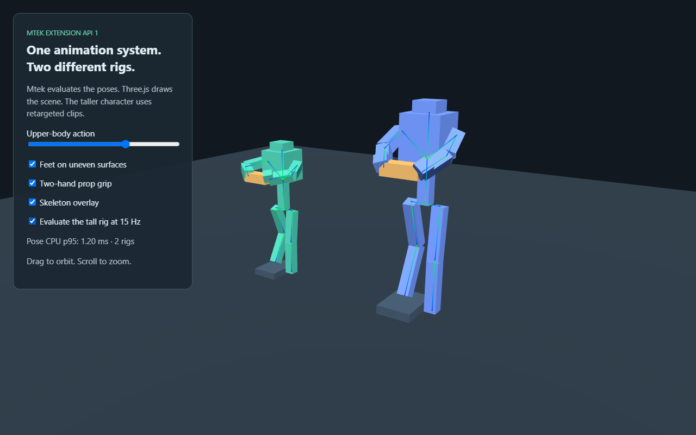

# Platform step implementation scorecard

Date: 2026-10-27. This records an implementation increment against the supplied
ten-item platform request. **The entire request is not complete.** Existing frozen
AI benchmark evidence was not modified or used as source examples.

The [compute continuation](shader-authoring/compute-continuation-2026-10-27/checkpoint.md)
revalidates the current code on both desktop backends and adds shadow restoration
after pending dispatch plus a second changed output through a recovered handle.
Capability metadata is checked against both successful public packaging and the
material-local E4901 rejection. This closes that focused continuation; it does
not close the remaining platform work below.

A [material/lighting calibration increment](material-lighting-2026-10-27/checkpoint.md)
fixes PBR colour opacity and passes five procedural categories at two qualities
on both desktop backends. Production-product tangent import and the complete
timing/presentation/regression protocol remain required. Visual comparisons are
recorded separately from performance acceptance.

The [tangent integration](tangent-progress.md) now imports and preserves authored
frames, exposes vertex/surface fields, and supports static/skinned mapped PBR,
authored replacements, instance transforms and derivative fallback. Thirty-two
focused hardware/software checks, 114 broader rendering/animation checks and 18
current compute checks pass. The unchanged WaterBottle passes both hardware
profiles with source/packed-byte identity and visible normal-map controls.
The software product comparison remains failed at the native Three normal-map
visibility gate; its source image/shader bytes match but generated mip bytes
differ between backends. No gate or reference renderer was changed to force a
pass. Qualified material timing/presentation and wider devices remain open.

The [qualified material measurement runner](../../spec/decisions/0213-qualified-material-measurements.md)
now separates CPU/GPU/count/native-presentation instruments, captures actual Windows
ETW display events, retains interference observations and verifies raw reports.
Full 240-pass acceptance remains pending; preflights are not performance evidence.
The [pause checkpoint](material-measurement-2026-10-27/checkpoint.md) records exact
native/readback product images for both engines, a passing RAF-only negative
control, and the latest eight interference rejections. A fresh protocol-3 visual
matrix and full qualified run are still required after the output-path correction.

Current scheduling: on 2026-10-27 the user explicitly re-enabled CPU/GPU tests
and animation optimization, including while doing other work. Earlier deferrals
no longer apply. A fresh 210-pass animation baseline is complete. The
[optimization increment](animation-optimization-2026-10-27/checkpoint.md) passes
1,652 runtime unit tests, 70 hardware/software browser checks and both complete
210-pass timing matrices. At 50 actors it uses about 46% less logical GPU buffer
memory and 8–9% less GPU pass time. Whole-frame CPU changes are mixed, including
a Fox regression; unchanged Three.js controls also drift. No whole-frame CPU win
is claimed. All eleven existing package budgets hold.

A [second rendering increment is validated](rendering-channels-progress.md):
core glTF material maps, mip-aware sampling and lossless metadata compaction.
Its separate record includes 42 passing hardware/software GPU checks and package
budgets. The historical checks below describe the preceding committed increment.

A [third rendering increment](lighting-progress.md) adds directional shadow
quality levels and HDR environment lighting, validated by 64 hardware/software
GPU checks. It includes a standalone lighting studio and preserves all eleven
existing example package budgets.

An [animation increment](animation-progress.md) adds synchronized locomotion, mounted
distance policies, orientation/hinge IK, explicit retarget frames and shared-pose
crowd instancing. Its final GPU run passes 40 hardware/software checks.

A [matched animation/character increment](matched-animation-progress.md) adds two
pinned authored assets, a textured clip demo and a complete 210-pass comparison
against Three.js WebGPU. Correctness gates pass; the report records higher Mtek
CPU/GPU time and GPU buffer use, with lower JS heap in these workloads. CPU noise
waits/retries without relaxing the measurement limits.

An [external inspector/SDK increment](inspector-progress.md) adds a separately
packaged optional panel, transform history, animation inspection and local-tarball
compatibility evidence. Eleven focused tests and GPU-disabled DOM checks pass.
Its real studio rendering check now passes on Radeon and SwiftShader; animation
performance work now has a measured increment with the limitations above.

A [spatial inspection increment](inspection-2026-10-27/checkpoint.md) now adds
copied world/camera/physics state and animation transition/layer/IK diagnostics.
An optional Canvas2D overlay and original-character studio pass independent
transformed-coordinate, composition, contact, recovery/reset and disposal checks
on both desktop backends. Declaration compaction and validator string pooling
retain all eleven existing package limits without increases. Broader authoring
workflows, provenance/history and persistent authored IDs remain open.

## Delivered behavior

- GPU skeletal deformation, shared immutable geometry/influences, palette-only
  animated uploads, conservative animated bounds, and deformation after culling.
- Independent animation controller with explicit pose throttling, ordered masks,
  override/additive layers, procedural overrides, bounded positional IK, base
  translation root-motion ownership and validated compatible-rig retargeting.
- A working [Three.js integration](../../examples/incremental-animation/README.md)
  demonstrating upper-body actions, feet on different heights, two hand grips,
  different proportions, pose throttling and skeleton overlays.
- Extension API 1, lifecycle rollback/disposal, frame-hook isolation, copied scene
  snapshots and validated batched transform updates, plus supplied host services.
- An independent asynchronous asset pool with custom loader API 1, shared leases,
  streaming progress, cancellation, origin capabilities, integrity checks and
  deterministic resource release.
- Linear-light asset mipmaps, including NPOT edges, additive material selection,
  and ordered custom WGSL LDR post effects with bounded scratch resources.
- Optional adapter shape sweeps, collision filtering, character movement queries,
  contact inspection and opt-in CCD for dynamic bodies through the mounted host.
- Correct Node type-stripping version boundaries in the CLI runner/npm engine range,
  and editor highlighting synchronized with the existing animation namespace.

An [asset-audit increment](asset-audit-progress.md) adds a pinned corpus,
separate import/use reporting and retained compiler diagnostics. The tangent
integration expands it to 21 inputs and 38 serial checks matching their expected
outcomes. Expected rejections are not compatibility successes.

## Explicit shader-authoring track

[Mtek-authored vertex and compute shaders](shader-authoring-plan.md) are now an
explicit required workstream, added at the user's request on 2026-10-26. A [first vertex increment](shader-authoring-progress.md) implements authored
local-position functions, vertex-visible resources, conservative culling,
instancing and matching directional shadows. A [structured-output increment](shader-authoring-structured-progress.md) adds normal/UV outputs and typed varying payloads with location/interpolation checks.
An [authored-bounds increment](shader-authoring-bounds-progress.md) adds bindable final local spheres, culling/sorting and copied inspection. A [production-character increment](shader-authoring-characters-progress.md) validates bounded skin/deformation/shadow/recovery cases against CPU-skinned references and preserves original mixed-filter samplers. World-space bounds/skeleton/IK/collision overlays and transition/layer diagnosis are now delivered by the [spatial inspection increment](inspection-2026-10-27/checkpoint.md). The compatible-rig composition below extends that evidence; wider physical-device evidence remains. The plan
retains compute resources/dispatch, lifecycle/recovery and full validation.
Runtime-internal compute and host WGSL effects do not satisfy this requirement.
A [compute-backend increment](shader-authoring-compute-progress.md) adds typed
entries/builtins, explicit storage access and independently checked memory
layouts. Source declarations/resources/kernels now parse and type-check, with GPU
effects and bounded workgroups. E4901 blocked runnable packaging then; kernel
lowering, manifest/runtime dispatch, lifecycle and end-to-end evidence were
required at that earlier checkpoint. The subsequent increments below record the
current implementation and acceptance boundary.
An [additional compute lowering/editor checkpoint](shader-authoring/compute-lowering-2026-10-26/checkpoint.md)
connects checked declarations to typed IR and Naga-validated kernel WGSL, while
retaining the public E4901 packaging gate. Editor continuation indentation now
passes the formatter corpus, 81 unit tests and 11 real VS Code integration tests.
Compute GPU acceptance and the compute-to-render path were unfinished at that checkpoint.
An [artifact/resource-owner increment](shader-authoring/compute-ownership-2026-10-26/checkpoint.md)
adds validated compute artifacts with separately content-addressed maps, shared
compiler/runtime layouts, and internal owners for upload/dispatch/readback,
replacement, cancellation and device recovery. A subsequent
[packaging/mounted increment](shader-authoring/compute-packaging-2026-10-26/checkpoint.md)
connects manifest/schema packaging, generated source-default writers, inspection,
public host handles, shader loading, replacement and device recovery. All eleven
example package budgets hold without raising limits. Ordinary source analysis
still emitted E4901 pending numerical GPU/render acceptance; CPU fake checks do not
establish it. The planner packaging guard is removed.

A [position render-bridge increment](shader-authoring/compute-render-2026-10-26/checkpoint.md)
borrows completed scalar xyz output for one declared entity, with explicit finite
bounds, instancing isolation, pending/failure suppression, disposal and recovery.
Scene changes now preserve identical program compute handles and retire their
scene-local attachments. Compiler-produced fixture and CPU fake checks establish
the command/lifetime path; real WGSL arithmetic, pixel/shadow references and
physical-device acceptance were still open at that checkpoint. Source E4901 was retained then.

A [compute acceptance preflight](shader-authoring/compute-acceptance-preflight-2026-10-27/checkpoint.md)
now prepares a focused hardware/software suite with real compiler packages,
independent CPU/direct-WGSL references, raw numeric/pixel records and lifecycle
checks. CPU preparation, reference-shader validation and test discovery are
checked. Its historical GPU NOT-RUN boundary is superseded by the
[actual GPU checkpoint](shader-authoring/compute-gpu-2026-10-27/checkpoint.md):
scalar/invocation arithmetic, composite kernels, independent geometry references,
device recovery and resource lifetime pass on Radeon and SwiftShader. All eight
packaged kernels execute over 13 numerical cases. That checkpoint retained E4901
pending shadow references and capability alignment.

The [public compute acceptance](shader-authoring/compute-release-2026-10-27/checkpoint.md)
now closes that bounded desktop acceptance: nine tests pass on each backend,
including independent low/medium/high shadow references, off-camera casters,
final bounds, pending output, completed-snapshot recovery and detach. Ordinary
source analysis/build packages standalone compute without bypassing diagnostics.
Context, LSP, grammar, coverage, release docs and the actual
[compute geometry example](../../examples/compute-geometry/README.md) agree on
the bounded API 1 contract. E4901 rejects material-local compute only. The full
shader track and wider physical-device evidence remain open.

The [authored cohort increment](shader-authoring/cohorts-2026-10-27/checkpoint.md)
now validates original Fox/CesiumMan skinning with authored outputs and shared-pose
instancing at 1/10/50 actors, plus CPU references, bounds/culling, shadows,
detach/rejoin and recovery. A live public-API demo exercises five distinct poses,
independent players and fragment-only transform references. Both desktop backends
pass; this adds no whole-frame timing or wider physical-device claim.

The [production composition workflow](character-composition-2026-10-27/checkpoint.md)
now combines locomotion, masked override/additive action, procedural adaptation,
feet on unequal heights, two-hand props and host-owned travel on original
CesiumMan geometry and a generated compatible proportion variant. It passes 32
variable-rate CPU cases, interruption/marker checks and independent CPU/GPU
render references on both backends, including unfinished-fade recovery and repeated
UI resets. This delivers the requested compatible-rig animation demonstration;
it does not establish arbitrary humanoid mapping or another physical-device tier.
The same checkpoint rechecks all 18 compute acceptance tests and capability
alignment against the current runtime. All 1,661 runtime tests, 86 broader
animation/rendering/inspection browser checks and eleven package budgets pass.

## Request acceptance status

| Area | Status | Remaining work before the requested acceptance criteria are met |
|---|---|---|
| 1. Scalable skeletal animation | Implemented + measured on one desktop | GPU skinning, animated culling, shared-pose cohorts and distance policies are implemented. The requested 1/10/50 independent-character comparison at two mesh complexities now has complete p95 CPU/GPU/upload/memory and correctness evidence. Mtek retains higher GPU time/buffer use in these unlit workloads and whole-frame CPU changes are mixed; a measured optimization reduces GPU time/buffers with mixed whole-frame CPU results; further CPU investigation and wider hardware evidence remain. |
| 2. Composable/adaptable animation | Requested compatible-rig workflow demonstrated on desktop | The production composition workshop combines locomotion/actions, unequal foot heights, two-hand props, generated different proportions, procedural adaptation and root ownership. Interruptions, phase markers, four frame-rate patterns, independent render references, device recovery and resource release pass. The mapping and foot/prop adaptation are explicit and scene-specific; general 2D blend spaces, anatomical solving and automatic humanoid mapping are extensions beyond this delivered compatible-rig workflow. |
| 3. Core rendering/materials | Partial | Core glTF texture channels, mip-aware sampling, directional shadows and HDR environment lighting are implemented and tested. Authored position/normal/UV results, typed payloads, finite bounds and combined animation compositions have CPU/GPU references; mixed min/mag samplers are preserved. Bounded source compute passes numerical, geometry, shadow and lifecycle acceptance. PBR colour opacity is corrected, and five procedural material/lighting categories pass at two qualities on both desktop backends. Authored tangent import/shading is implemented and the unchanged product passes the complete hardware matrix. The native-reference software normal-map control remains failed; qualified matched costs and wider physical devices remain. HDR display/effects and cascaded/point shadows are further extensions. |
| 4. Incremental adoption | API/package proof and rendered check delivered | Animation/content APIs and the Three.js integration exist. The optional inspector is separately packaged, installed and strictly type-checked without source aliases, with mounted lifecycle/version tests and a documented compatibility policy. Its opt-in lighting-studio rendering check passes edit/undo/redo/reset/removal on Radeon and SwiftShader. Packages remain private development snapshots; stable release/external adoption evidence remains. |
| 5. Asset/content pipeline | Partial | A pinned 16-input compatibility corpus and serial audit tool now separate declaration import from named mesh/material/clip use; the original 26 checks matched expected outcomes. A subsequent [30-check run](shader-authoring/characters-2026-10-26/asset-audit/report.md) now accepts original CesiumMan mesh/material/clip use and mixed min/mag filters, retaining the original provenance. The current tangent/product increment expands the pinned audit to 21 inputs and 38 matched import/use outcomes. Morphs, cubic-spline playback, compression, compiler-integrated async scene streaming, LOD, unloading/plateau evidence and a broader production corpus remain. The independent pool does not change the strict GLB profile. |
| 6. Movement/spatial queries | **Done** (decisions 0214–0218, local desktop gate) | Every acceptance item of [0214](../../spec/decisions/0214-complete-character-movement.md) holds and is tested. Programs move kinematic characters with `move_character` (collide-and-slide, stair stepping, slope limit, ground snapping, carry by horizontal, vertical and rotating kinematic platforms) and read `grounded`/`ground_normal`; `CapsuleCollider` and per-body `continuous` exist. Hosts and extensions get `app.physics` ray/shape casts, contacts and collision groups by entity ID. A real-engine corpus (stairs, slopes, walls, corners, ceilings, gaps, thin walls, platforms; capsule/sphere/box; fixed steps 1/30–1/144 s) generates the operating ranges of `spec/physics.md` 7.2, asserted by tests. CCD: lanes D06/D08 were caused by flagging the obstacle too and are fixed; 0 tunnels in about 86,000 measured lanes inside the published 7.1 envelope. `examples/character-movement` and `specs/movement/character.spec.ts` pass on Radeon and SwiftShader, including bit-identical results under 1/30, 1/60, 1/144 s and jittered frame times. Published exclusions (not hidden): thin walls above 1 m per tick, stair end positions differing up to 0.35 m between fixed steps, obstacles approaching faster than 1 m/s under CCD, unswept teleports, spawned colliders invisible to queries until the next step. Wider physical devices belong to area 7. |
| 7. Browser/device contract | Partial | The CLI's Node version mismatch was fixed and existing hardware/SwiftShader browser coverage was exercised. No new real-device CI or mobile/integrated-GPU evidence was obtained. WebGPU remains required. |
| 8. Inspection/authoring | Partial | An optional public-API inspector now supports selection, local transform edits/history, animation scrubbing, mesh-local joints and optional host metrics; fake-GPU mounted and GPU-disabled DOM checks pass. Its real studio check passes edit/undo/redo/reset/removal on Radeon and SwiftShader. World bounds/skeleton/IK/collider/contact overlays and transition/layer diagnostics now pass independent transformed-coordinate, composed-character, recovery/reset and disposal checks on both desktop backends. Resource provenance/history, persistent authored IDs and end-to-end workflows remain. |
| 9. Fair workload evidence | Partial | The frozen animation comparison and fresh 210-pass before/after runs against pinned Three.js retain three-repeat p95s, memory, rejected attempts and visual gates on one desktop. Five procedural material/lighting categories now pass two quality profiles against Three WebGPU, with independent particle contribution/structure gates and all-encoder timestamp-instrument preflights. The unchanged product now imports and passes both hardware profiles with visible normal-map controls. The two software product controls remain failed and are retained with native mip diagnostics. Qualified material timings, streaming/long-session workloads, regression budgets, a second maintained runtime, presentation evidence and other hardware tiers remain. No general superiority claim follows. |
| 10. Language/compiler advantage | Partial; shader-authoring desktop evidence delivered | Mtek source authors position/normal/UV/tangent vertex functions and typed payloads, with GPU effects, source maps, inspected interpolation/locations and reference checks. Authored finite bounds, shared cohorts and production-character animation compositions now match CPU references through recovery. Bounded source compute and aligned capabilities are delivered. Wider physical-device evidence, compiler asset optimization, a reproducible release process and human/AI productivity evidence remain. Existing token-efficiency claims gain no support from these increments. |

## Reproducible checks

Unit coverage lives beside the implementation in `packages/runtime-web/src/` and
`packages/physics-rapier/src/queries.test.ts`. Hardware arithmetic/pixel probes are:

```
npm run build
npm run test -w @mtek/browser-tests -- specs/animation --project=hardware
npm run test -w @mtek/browser-tests -- specs/m5/physics-tunnelling.spec.ts --project=hardware
```

The GPU deformation matrix covers 1, 10 and 50 independent actors with 63 and 1025
vertices (both exercise partial workgroups), compares position/normal readback
against CPU inverse-transpose skinning, asserts exactly actors × joints × 64 bytes
per palette update, and verifies zero retained tracked resources. These are
synthetic correctness/transfer checks, not character-quality or timing benchmarks.

Hardware probes ran on Windows 11, Chromium 153.0.8010.12, AMD Radeon RX 7900 XTX,
with no fallback adapter: [environment](rx7900xtx/environment.json). SwiftShader
ran on the same host: [software environment](rx7900xtx/software-environment.json).
These are not separate physical-device tiers. New runs used Node 22.23.2.

Sanitized records preserve numbers, statuses and timestamps:

PNG attachments from the broader run are stored byte-for-byte in
[`rx7900xtx/attachments/`](rx7900xtx/attachments/manifest.json), with SHA-256 hashes;
the report references these files instead of embedding their base64 bodies.

- [Initial targeted checks](rx7900xtx/tests.json): 10 passed, 0 failed, 0 NOT-RUN.
- [Broader browser run](rx7900xtx/full-regression-before-node-fix.json): 504 passed,
  21 failed, 15 intentionally skipped. All 21 failures came from the CLI's old
  Node-24-only gate; no renderer test failed. The failure record is retained.
- [CLI cases after the version fix](rx7900xtx/cli-regression-after-node-fix.json):
  23 passed, 0 failed, 15 intentionally skipped. This reruns every prior failure.
- [Graphics after the layered-transition fix](rx7900xtx/graphics-after-continuity-fix.json):
  16 passed, 0 failed, 0 NOT-RUN across hardware and SwiftShader. This includes
  post-effect device recovery, disposal and invalid-WGSL rejection.
- [CCD lane data](rx7900xtx/ccd-lanes.json) preserves the moving-plate limitation.
  In particular D06 (x=3.065 m, 9 m/s) still passes the plate with mounted all-body
  CCD enabled. The isolated adapter regression at 240 m/s passes, so the results
  do not establish a general tunnelling fix.

The complete Rust workspace suite passed, including 43,183 grammar-conformance
inputs and the backend smoke test. Subsequent runner-version and prerequisite
tests, embedded-runtime/provenance tests and Clippy passed. The final runtime
unit run passed 1,554 tests; the physics adapter passed 81. Editor tests passed
79 and release-documentation tests 127. One parallel type-checking test hit its
old 5-second timeout; its isolated rerun passed, its integration timeout was made
explicit, and the complete runtime suite then passed with four workers.

Build, TypeScript, lint, generated release documentation, feature coverage,
asset generation, baseline consistency and package budgets were checked. The
embedded runtime was regenerated and checked byte-for-byte against the built files.
The minified runtime grew by 34,007 bytes and declarations by 6,095 bytes versus
the previous embedded files. Non-physics package limits were increased by a fixed
40,000 bytes for this feature cost, retaining approximately their existing margin;
physics-playground's limit was not increased. This is a cost, not an optimization.

The standalone integration was opened in Chromium, all controls were exercised
and a screenshot inspected. No browser page errors were observed. The demo's live
p95 display measures only its pose CPU work and is not a matched-engine result.


